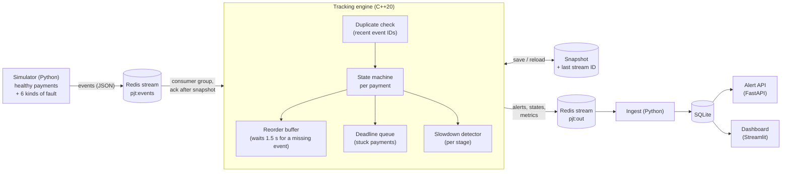

# Payment Journey Tracker

Follows every simulated payment from start to finish with a C++ engine, and raises an alert
when one gets stuck, fails, skips a stage, arrives twice or changes amount, even if the engine
crashes halfway through.

> **Simulated data only.** Every payment here is made up by the simulator in `sim/`. No real
> payment or customer data is used. This is a learning project, not a production system.

**Demo video:** _to be recorded_ (script: [docs/demo.md](docs/demo.md)).

## Run the demo (one command)

Needs [Docker Desktop](https://www.docker.com/products/docker-desktop/) (on Windows, with WSL 2).

```bash
git clone https://github.com/Bplhansi/payment-journey-tracker.git
cd payment-journey-tracker
docker compose up --build
```

The first build takes a few minutes. Then open:

- **Dashboard:** http://localhost:8501 (open alerts, payments per stage, payment search, engine speed)
- **API:** http://localhost:8000/docs (see [docs/api.md](docs/api.md))

The simulator sends 15,000 payments in real time (about 5 minutes). Try these in a second
terminal while it runs:

```bash
docker compose exec api python -m sim.inject stuck    # one new stuck payment; search its ID on the dashboard
docker compose kill engine                             # crash the engine...
docker compose start engine                            # ...and watch it recover
```

Stop with `Ctrl+C`, then `docker compose down --volumes` to delete the data.

## How it works



Events flow one way. Only problems and payment updates come out of the engine.

Each payment moves through five stages, and can fail from any of the first four
([full state diagram and rules](docs/states.md)):

```mermaid
stateDiagram-v2
    direction LR
    Received --> Validated --> Screened --> Sent --> Settled
    Received --> Failed
    Validated --> Failed
    Screened --> Failed
    Sent --> Failed
```

| Fault the simulator injects | What the engine does | Alert |
| --- | --- | --- |
| **Stuck:** a payment stops moving | a deadline per stage fires (4 to 6 s) | `stuck`, cleared if it moves again |
| **Duplicate:** the same event twice | the repeat is ignored | `duplicate` notice, counted once |
| **Out of order:** a later event first | held briefly, then applied in order | `out_of_order` notice |
| **Skipped stage:** an event never comes | held 1.5 s, then reported and applied | `invalid_journey` |
| **Failed** | moves to Failed | `failed` |
| **Amount change** between stages | compared with the first amount | `amount_mismatch` |

Money is stored as whole minor units (pence, cents), never as decimals, so no rounding
errors can creep in.

### Handling duplicates (idempotency)

Every event has its own ID. The engine remembers recent IDs (the last 200,000) and ignores
any it has already seen, so processing an event twice changes nothing. This is what makes
crash recovery safe: after a restart some events are delivered again, and they are simply
ignored. A test feeds 20 shuffled, duplicated versions of the same stream to the engine and
checks every final state and alert is identical (`engine/tests/test_ordering.cpp`).

### Surviving a crash

A stuck payment sends no event, so the engine has to remember everything it knows. It works
like this:

1. About once a second the engine saves a **snapshot** of its whole state, including the ID
   of the last stream entry it covers. The file is written to a temporary name and renamed,
   so a crash never leaves half a snapshot.
2. Only after that does it **acknowledge** those events in Redis. Unacknowledged events stay
   in Redis's pending list.
3. On restart it loads the snapshot and **re-reads its unacknowledged events**. Ones inside
   the snapshot are skipped; the rest are processed again, and duplicate handling makes any
   repeats harmless.
4. Everything downstream is stored by ID, so receiving the same alert twice changes nothing.

`scripts/crash_test.py` kills the engine with no warning (`SIGKILL`) while events are still
arriving, restarts it, and compares every payment's final state and every alert with a
run that never crashed.

## Results

Measured on a 4-core Intel Xeon @ 2.10 GHz cloud machine (Linux, GCC 13, `-O3`), with the
default settings in `config/engine.ini`. Full details and how to re-run them:
[docs/results.md](docs/results.md).

**Alerts** (50,000 simulated payments, 243,930 events):

| Fault | Injected | Detected | False alarms | Median detection delay |
| --- | ---: | ---: | ---: | ---: |
| Stuck | 1,529 | 1,529 | 0 | 5,000 ms |
| Duplicate | 1,492 | 1,492 | 0 | 0 ms |
| Out of order | 1,517 | 1,517 | 0 | 426 ms |
| Skipped stage | 1,527 | 1,527 | 0 | 2,165 ms |
| Failed | 1,518 | 1,518 | 0 | 0 ms |
| Amount change | 1,574 | 1,574 | 0 | 0 ms |

Detection delay is in payment time. For stuck payments it is measured from the last event,
so it equals the stage's time limit; for a skipped stage it is from when the missing event
should have happened, plus the 1.5 s wait.

**Speed and reliability:**

| Metric | Result |
| --- | --- |
| Engine alone, replaying a file | ~111,000 events/s; 7.3 µs median, 34 µs p99 per event |
| Live through Redis, highest steady rate | 40,000 events/s (median processing delay 38 ms; 8.8 µs median, 64 µs p99 per event) |
| Correct final states after a crash | 100% (5,000 of 5,000 payments; all 917 alerts identical) |
| Recovery time after a crash | 0.14 s to catch up (re-reading 2,530 unacknowledged events) |
| Gradual slowdown | flagged 23.7 s before the fixed time limit caught it |

## Run it without Docker (Windows, macOS or Linux)

You need a C++20 compiler, CMake 3.20+ and Python 3.11+. On Windows, use Visual Studio 2022
(with "Desktop development with C++") and run these in Git Bash or PowerShell.

```bash
# 1. Build the engine and run its tests
cmake -S engine -B engine/build -DCMAKE_BUILD_TYPE=Release
cmake --build engine/build --config Release
ctest --test-dir engine/build -C Release --output-on-failure

# 2. Python packages and tests
python -m venv .venv
source .venv/Scripts/activate         # Git Bash on Windows; macOS/Linux: source .venv/bin/activate
pip install -r requirements-dev.txt
python -m pytest

# 3. Simulate, run the engine over the file, score it
python -m sim.generate --payments 5000 --out data
engine/build/Release/pjt_replay data/events.jsonl --out data/records.jsonl   # macOS/Linux: engine/build/pjt_replay
python -m scripts.evaluate

# 4. Look at the results in the API and dashboard
python -m api.ingest --file data/records.jsonl
uvicorn api.app:app --port 8000        # in one terminal
streamlit run dashboard/app.py         # in another
```

A crash test that needs no Redis: stop the replay part-way, then resume it from its snapshot.

```bash
engine/build/Release/pjt_replay data/events.jsonl --out data/crash.jsonl --snapshot data/replay.snapshot --stop-after 12000
engine/build/Release/pjt_replay data/events.jsonl --out data/crash.jsonl --snapshot data/replay.snapshot --resume
```

The live Redis reader (`pjt_stream`) needs the hiredis library, so it is built in Docker and
on Linux (`sudo apt install libhiredis-dev`, then add `-DPJT_WITH_REDIS=ON`). With Redis
running, `python -m scripts.crash_test` and `python -m scripts.load_test` test the live path.

## Project layout

```
engine/          C++ tracking engine
  include/pjt/   headers: stage.hpp (state machine), tracker.hpp (the engine), ...
  src/           tracker.cpp, replay_main.cpp (file replay), stream_main.cpp (live, Redis)
  tests/         GoogleTest unit tests
sim/             Python payment simulator, Redis publisher, live fault injector
api/             SQLite storage, ingest worker, FastAPI alert service
dashboard/       Streamlit live dashboard
scripts/         evaluate.py, crash_test.py, load_test.py
tests/           Python tests
config/          engine.ini (time limits and other settings)
docs/            states, API, dashboard plan, results, demo script
```

## Known limits and next steps

- **Simulated faults are clean.** Every injected fault is clearly different from normal
  behaviour, which is why the scores are perfect. Real payment traffic is messier, and the
  time limits would need tuning against real stage timings.
- **One engine instance.** Scaling out would mean splitting payments across several engines
  by payment ID (each owning its own consumer and snapshot).
- **Stuck payments stay in memory** until they move again. A real system would archive them
  after a while.
- **Snapshots are whole-state JSON**, written about once a second. With millions of open
  payments, an append-only change log between snapshots would be cheaper.
- **Exactly-once delivery isn't possible** over a network; the system is at-least-once
  delivery plus idempotent processing, which gives the same result.
- **Next:** per-payment-type time limits, alert routing (email/Slack), and a replay tool to
  re-run any time window.

## Inspiration

Deutsche Bank describes PayTrack, a tool that monitors payments end to end and spots
incidents early. This project was inspired by that idea; it is not based on any knowledge of
how PayTrack works.
